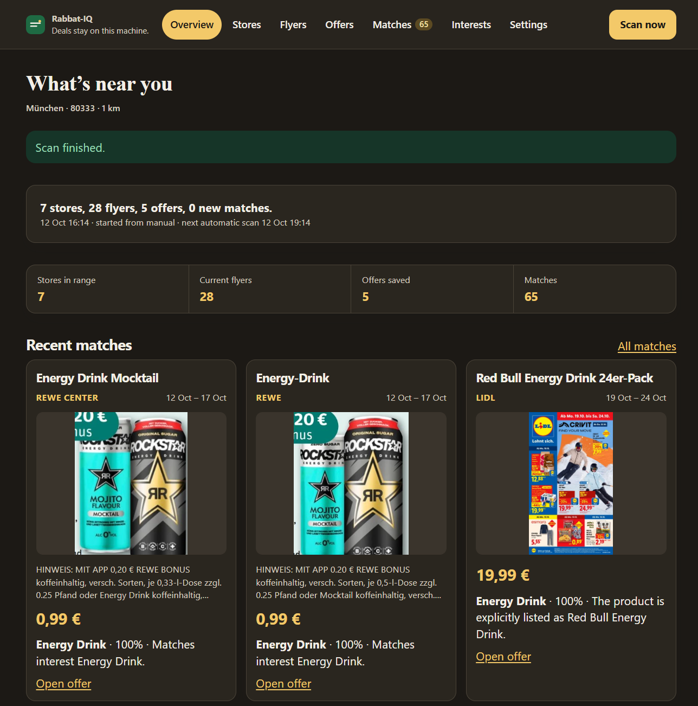

# Rabbat-IQ

[](https://github.com/ChrisKariofyllis/Rabbat-IQ/actions/workflows/ci.yml)
[](https://github.com/ChrisKariofyllis/Rabbat-IQ/pkgs/container/rabbat-iq)
[](LICENSE)



Self-hosted tool that finds supermarket deals near you. Scan flyers from nearby stores, match them to your interests with AI, and get Telegram alerts.

Rabbat-IQ is currently in beta. It is privacy-focused and self-hosted: interests, flyer images, matches, and API keys stay on the machine in a local SQLite database. You bring your own AI and Telegram credentials if you want those features. Keyword matching works with no key.

It is aimed at Germany and Austria. The first data source is [Marktguru](https://www.marktguru.de/). Direct chain scrapers can be added beside it.

## Quick Start

Clone this repository (or copy `docker-compose.yml` into a folder) and run:

```bash
docker compose up -d
```

The first run pulls `ghcr.io/chriskariofyllis/rabbat-iq:latest`. The first beta is also published as `ghcr.io/chriskariofyllis/rabbat-iq:v1.0.0-beta` if you want to pin that tag instead of `latest`.

Open http://127.0.0.1:8000. Compose binds port 8000 on localhost. The SQLite database lives in the `rabbat-iq-data` volume.

Then:

1. Set a postal code, country, and radius under Settings.
2. Add interests such as `Greek yogurt`, `beer`, or `Werkzeugkasten`.
3. Choose Scan now.

The scheduler (APScheduler, inside the app) repeats the scan on the interval you set in Settings (15–180 minutes, default 30). The first automatic run happens within about a minute after a postal code and at least one interest are saved.

If the published image cannot be pulled yet, uncomment `build: .` in `docker-compose.yml` and run `docker compose up -d --build`.

## Update

```bash
docker compose pull && docker compose up -d
```

That fetches a newer `latest` (or whichever tag you pinned) and restarts the container. The data volume is left in place.

## What a scan does

1. Turns your postal code into a place (Marktguru’s location search, then OpenStreetMap Nominatim if that fails).
2. Loads current leaflets for that postal code and keeps supermarket, discounter, drugstore, and hardware branches inside your radius.
3. Searches offers for each interest.
4. Matches them locally by keyword, or with your own vision/chat model if you turn that on.
5. Saves new matches and, when Telegram is configured, sends each one once.

The same offer, interest, price, and end date are not sent again.

## How nearby stores are found

Marktguru’s location search returns every hamlet that shares a postal code. The first hit is often on the edge, and the average of all of them can sit in the fields between villages. When one locality is named for the postal area itself (Sinzing for 93161, not Sinzing Adlstein), that point is the center. Otherwise the localities are averaged. Nominatim is used only when Marktguru returns no coordinates.

Branches come from two places, both measured from that center and kept only inside your radius:

1. Marktguru’s store list on the current leaflets, up to four leaflets per chain, so a smaller local booklet is not hidden by the chain’s biggest campaign.
2. OpenStreetMap supermarkets around that center, for branches a leaflet does not list. In Sinzing that is the Edeka on Am Reitfeld. If the map service is unavailable, the same chains are looked up by name in the town. A shop already returned by Marktguru is not added twice.

The map is a relative plot of those saved branches, not a street map.

## Flyer scope

Flyers are the leaflets Marktguru returns for your postal code. They are not a dump of every German leaflet. Each one is labeled:

- **Local** — one booklet (`spreadLeaflet` is false and `leafletCount` is 1). This is the tighter match for your area.
- **Broader** — a spread campaign, or a flight that stacks more than one leaflet. The offers still reach your postal code, and the same booklet is shared across many stores.

Local booklets are listed first. Broader ones stay on the page because weekly chain offers often live in those shared campaigns.

## Offer links

Open offer uses a direct product URL when the source has one, such as a Lidl product page or a Kaufland link that names an article id. Category overviews, ad trackers, and Marktguru search URLs are not used. When no specific product URL exists, the link is the Marktguru offer page at `/offers/{id}`.

## Build from source

### Docker

Uncomment `build: .` in `docker-compose.yml` (and optionally comment out the `image:` line), then:

```bash
git clone https://github.com/ChrisKariofyllis/Rabbat-IQ.git
cd Rabbat-IQ
docker compose up -d --build
```

### Python

Python 3.11 or newer:

```bash
git clone https://github.com/ChrisKariofyllis/Rabbat-IQ.git
cd Rabbat-IQ
python -m venv .venv
source .venv/bin/activate
pip install -r requirements-dev.txt
uvicorn app.main:app --host 127.0.0.1 --port 8642
```

Open http://127.0.0.1:8642.

Copy `.env.example` to `.env` if you want a different database path, HTTP basic auth, or your own Marktguru keys. Shopping settings (postal code, Telegram, AI provider, scan interval) are edited in the web UI and stored in SQLite, not in the env file.

## Telegram

1. Create a bot with [@BotFather](https://t.me/BotFather) and paste the token into Settings.
2. Open the bot and send `/start`. It replies with your chat id.
3. Save that chat id. From then on, only that chat can use the bot.

Commands: `/status`, `/interests`, `/add beer`, `/remove beer`, `/scan_now`, `/stores`.

Alerts include the product, price, store, validity, why it matched, and a picture when the source has one. Unsent matches are retried on a later scan, up to three attempts.

## AI providers

Keyword matching works with no key. It understands a short bilingual grocery list (`beer` / `Bier`, `yogurt` / `Joghurt`, `tools` / `Werkzeug`) and otherwise looks for your words. The same list is used to build the Marktguru query, so an English interest still searches the German index. “beer” is searched as Bier or Pils, because that index stems the English word into Beeren (berries).

| Provider | Default model | Key |
| --- | --- | --- |
| OpenAI | `gpt-4o-mini` | Your OpenAI API key |
| Gemini | `gemini-2.5-flash` | Your Gemini API key |
| Anthropic | `claude-haiku-4-5` | Your Anthropic API key |
| Ollama | `llava` | None. Set the base URL, usually `http://127.0.0.1:11434` |

Semantic mode asks the model which offers fit, including the same product in another language. Vision mode sends flyer covers (not every page) up to the page budget in Settings. Both are off until you opt in, because they spend your API credit. Results are cached locally so the same page is not billed twice.

The model is asked to return:

```json
{
  "matches": [
    {
      "interest": "Greek yogurt",
      "offer_id": "25289747",
      "product": "Joghurt",
      "price": "0.59",
      "original_price": "0.89",
      "discount": "−34%",
      "store": "Kaufland",
      "valid_from": "12 Oct",
      "valid_to": "18 Oct",
      "confidence": 0.86,
      "reason": "Griechischer Joghurt matches Greek yogurt"
    }
  ]
}
```

## Configuration

Environment variables use the `RABBAT_IQ_` prefix. See `.env.example`. Postal code, country, radius, scan interval, Telegram, and AI settings are stored in the database and edited in the web UI.

| Variable | Purpose |
| --- | --- |
| `RABBAT_IQ_DATABASE_URL` | SQLite URL. Default `sqlite:///./data/rabbat-iq.db`. Compose uses `sqlite:////data/rabbat-iq.db` |
| `RABBAT_IQ_DATA_DIR` | Key cache and other local files. Default `./data` (Compose: `/data`) |
| `RABBAT_IQ_HOST` | Bind address. Default `0.0.0.0` |
| `RABBAT_IQ_PORT` | Bind port. Default `8000` |
| `RABBAT_IQ_LOG_LEVEL` | Log level. Default `INFO` |
| `RABBAT_IQ_BASIC_AUTH_USER` / `RABBAT_IQ_BASIC_AUTH_PASSWORD` | Optional password for the web UI |
| `RABBAT_IQ_MARKTGURU_API_KEY` / `RABBAT_IQ_MARKTGURU_CLIENT_KEY` | Optional. Otherwise keys are read from the public homepage and cached for 12 hours |
| `RABBAT_IQ_POSTAL_CODE` / `RABBAT_IQ_COUNTRY` | Used only when the database is first created |
| `RABBAT_IQ_DISABLE_SCHEDULER` / `RABBAT_IQ_DISABLE_BOT` | For tests and local debugging. Leave unset in normal use |

If you publish the port beyond localhost, set the basic-auth variables.

## Adding a source

`app/adapters/base.py` describes the interface: geocode, leaflets, nearby stores, and offer search. `app/adapters/chain_template.py` is a copy-ready skeleton. Register the class from `app/adapters/registry.py` and include it in `build` / the scan’s source list.

A new adapter should identify itself with a clear User-Agent, wait between requests, and cache work it has already done. Read the site’s robots.txt and terms first. Do not bypass logins or other access controls.

## Privacy

- Interests, matches, and keys are in the local SQLite file.
- Marktguru is contacted only to load public offer data for the postal code you set.
- Nominatim is contacted only when Marktguru cannot locate that postal code.
- Your AI key is sent only to the provider you select.
- Telegram receives a match only when a token and chat id are saved.
- The UI sends `noindex` and `robots.txt` disallows crawlers. It is a personal tool, not a public site.

## Tests

```bash
pip install -r requirements-dev.txt
pytest
```

## Legal

Rabbat-IQ is an unofficial, personal, self-hosted client. You are responsible for complying with the terms of Marktguru and of any site you add a scraper for. Prefer the public aggregator API. This project does not ship scrapers for Lidl, Aldi, Rewe, or other chains.

Offer text, prices, and images remain the property of their sources. The relative store map is computed locally and does not load map tiles.

## Layout

```
app/
  main.py                 web process, auth, security headers
  scheduler.py            interval taken from settings
  adapters/               Marktguru, plus a scraper template
  ai/                     keyword matcher and model clients
  notifications/          Telegram alerts
  bot/                    /status, /add, /scan_now, and the rest
  services/               database and the scan pipeline
  web/                    pages, CSS, and the scan poller
```
